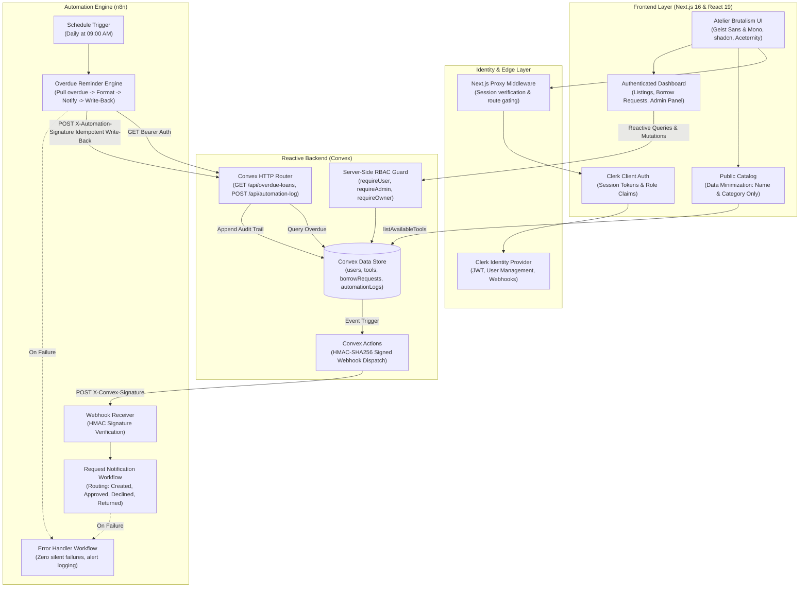

# 🛠️ LendLoop — Neighborhood Tool-Lending Board

> *"Borrow what you need. Lend what you don't."*

[](https://lendloop-two.vercel.app)
[](https://github.com/DIABY007/lendloop)

🔗 **Déploiement en ligne :** [https://lendloop-two.vercel.app](https://lendloop-two.vercel.app)

LendLoop is a neighborhood equipment-sharing platform engineered with **Next.js 16 (App Router)**, **Convex** reactive backend, **Clerk** authentication, and **n8n** automation workflows. 

Designed under the **"Atelier Brutalism & Précision Suisse"** design system, LendLoop brings tactile elegance, strict data minimization, and automated operational intelligence to the local sharing economy.

---

## 🏗️ System Architecture



---

## 🌟 Key Features

### 1. 🛡️ Public Catalog with Strict Data Minimization
* **Zero PII Leakage:** Public visitors can browse available equipment by category. Owner identities, contact emails, and personal details are strictly stripped at the database query level (`convex/tools.ts`).
* **Instant Onboarding:** Tactile Clerk authentication modal allows instant sign-in or registration to borrow or list tools.

### 2. 🧰 Authenticated Neighborhood Experience
* **Tool Registration:** List tools with name, category (*Power Tools, Garden, Kitchen, Camping, Hand Tools*), condition (*Like New, Good, Fair* with 3-bar gauge), and description.
* **Borrow Requests:** Interactive modal with date-range selection and duration calculation.
* **Loan Lifecycle Management:**
  * Owners can review pending requests with **1-click Approve** or **Decline**.
  * Active loans can be marked as **Returned**, instantly restoring tool availability in the catalog.
* **Personal Management Hub:** Tabbed views for *All Tools*, *My Listings*, *My Requests*, and *Incoming Requests*.

### 3. 👑 Robust Server-Side RBAC (Role-Based Access Control)
* **User Role:** Strictly constrained to managing their own tools and loans.
* **Admin Role:**
  * Neighborhood community oversight dashboard.
  * Delete any tool listing across the platform.
  * Audit all global loans with borrower/lender transparency.
  * Award or revoke the verified **"Trusted Lender"** badge.
* **Security Invariant:** All permission checks are executed server-side inside Convex queries and mutations (`convex/lib/auth.ts`), never relying on client-side state.

### 4. ⚡ Automated n8n Workflows
* **Real-time Notifications (`request-notification.json`):** Webhook dispatched on loan creation, approval, decline, and return. Cryptographically verified with HMAC-SHA256.
* **Scheduled Overdue Reminders (`overdue-reminders.json`):** Runs daily at 09:00. Queries overdue loans via authenticated Convex HTTP endpoint, formats reminders, and writes back an audit record with deterministic idempotency keys (`reminder-{loanId}-{YYYY-MM-DD}`).
* **Global Error Handler (`error-handler.json`):** Listens to execution failures across all workflows to prevent silent drops.
* **Live In-App Audit Trail:** Loan cards display automated activity logs directly in the UI (*"Reminder sent 2 days ago"*).

---

## 🎨 Design Engineering: "Atelier Brutalism & Précision Suisse"

Crafted to meet the quality standards of Linear, Stripe, Raycast, and Apple:

| Element | Specification | Visual Rationale |
| :--- | :--- | :--- |
| **Palette** | Basalte Chaud (`hsl(28, 7%, 8%)`), Ocre Forgé (`hsl(34, 96%, 53%)`) | Replaces cold, generic zinc with warm, workshop-inspired metallic depth. |
| **Micro-LEDs** | Emerald (Available), Amber (In Loan), Brick (Overdue) | Immediate, live status at a glance with subtle pulse glow. |
| **Condition Gauge** | 3-bar mechanical segment (Like New: 3 bars, Good: 2 bars, Fair: 1 bar) | Tactile workshop measurement aesthetic. |
| **Typography** | `Geist Sans` for copy; `Geist Mono` with `tabular-nums` for dates and IDs | Eliminates layout jitter on real-time countdowns and metrics. |
| **Haptics & Motion** | `active:scale-[0.98]`, 120ms spring transitions | Immediate physical response on pointer-down (Apple Human Interface rule). |
| **Feedback** | Asynchronous mutations linked to Sonner `toast.promise` | Clear visual progress and error messaging for all actions. |

---

## 🚀 Quickstart & Local Setup

### Prerequisites
* **Node.js** >= 18.x
* **Docker & Docker Compose** (for self-hosted n8n)
* **npm** or **pnpm**

### Step 1: Clone & Install Dependencies
```bash
git clone https://github.com/DIABY007/lendloop.git
cd lendloop
npm install
```

### Step 2: Environment Configuration
Copy the template environment file:
```bash
cp .env.example .env.local
```

Fill in your configuration in `.env.local`:
```env
# Convex
CONVEX_DEPLOYMENT=dev:your-deployment-name
NEXT_PUBLIC_CONVEX_URL=http://127.0.0.1:3210 # or your cloud convex url

# Clerk
NEXT_PUBLIC_CLERK_PUBLISHABLE_KEY=pk_test_...
CLERK_SECRET_KEY=sk_test_...
NEXT_PUBLIC_CLERK_SIGN_IN_URL=/sign-in
NEXT_PUBLIC_CLERK_SIGN_UP_URL=/sign-up

# n8n Automation Engine
N8N_WEBHOOK_URL=http://127.0.0.1:5678/webhook/lendloop-request
N8N_WEBHOOK_SECRET=lendloop_shared_hmac_secret_key_2026
CONVEX_N8N_API_SECRET=lendloop_convex_api_bearer_token_2026
```

### Step 3: Start Convex Backend
Convex can run completely locally without an external cloud account, or connected to your Convex Cloud deployment:
```bash
# Option A: Run locally (recommended for rapid evaluation)
npx convex dev

# Option B: Run cloud deployment
npx convex dev --until-success
```
The Convex dashboard will be available at `http://127.0.0.1:3210` (or your cloud URL).

### Step 4: Start n8n Automation Engine
Run n8n locally via Docker Compose:
```bash
docker compose up -d
```
Access the n8n UI at **`http://localhost:5678`**.

### Step 5: Import n8n Workflows
1. Log into `http://localhost:5678`.
2. Go to **Workflows > Import from File**.
3. Import the 3 production workflows located in `/n8n-workflows`:
   * `request-notification.json`
   * `overdue-reminders.json`
   * `error-handler.json`
4. Set the workflow environment variables / credentials:
   * `N8N_WEBHOOK_SECRET`: `lendloop_shared_hmac_secret_key_2026`
   * `CONVEX_N8N_API_SECRET`: `lendloop_convex_api_bearer_token_2026`
   * `CONVEX_URL`: your Convex HTTP site URL (`http://127.0.0.1:3211` or cloud `.site` URL).
5. Activate the workflows.

### Step 6: Start Next.js Development Server
```bash
npm run dev
```
Open **`http://localhost:3000`** in your browser.

---

## 🔒 Security, Compliance & Data Privacy

LendLoop was built with principles applicable to high-trust, regulated environments (such as B2B healthcare, compliance, and clinical research):

### 1. Data Minimization by Design (GDPR Art. 5(1)(c) & HIPAA Analogy)
* Unauthenticated endpoints and public pages strictly expose only `name` and `category`.
* PII (owner names, email addresses, loan timeframes) are quarantined behind authentication boundaries.
* Contact information is only shared between the two confirmed parties once an owner explicitly approves a loan.

### 2. Cryptographic HMAC-SHA256 Webhook Integrity
* All outgoing webhooks from Convex to n8n are signed with `X-Convex-Signature: sha256=<hex_digest>` using a pre-shared secret.
* n8n verifies this signature before parsing or processing payloads, preventing forged webhook triggers.
* Write-backs from n8n to Convex (`POST /api/automation-log`) require both `Bearer` token authentication and payload HMAC signing (`X-Automation-Signature`).

### 3. Server-Side RBAC & Non-Repudiation
* Client-side permission flags (`isAdmin`, `isOwner`) only adjust UI presentation.
* Every mutation executes `requireUser`, `requireAdmin`, or `requireOwner` server-side inside Convex transactions.
* Every administrative and automated action generates an immutable audit record in the `automationLogs` table.

### 4. Idempotent Write-Backs & Replay Attack Defense
* Overdue reminders generate deterministic idempotency keys:
  ```typescript
  const idempotencyKey = `reminder-${loan._id}-${new Date().toISOString().split("T")[0]}`;
  ```
* If n8n retries a failed execution or the cron triggers multiple times, Convex deduplicates the event, preventing spam and corrupted loan state.

---

## 📈 Production Readiness & Scaling Notes

| Dimension | Production Recommendation |
| :--- | :--- |
| **High Availability n8n** | Deploy n8n in **Queue Mode** using Redis and a dedicated PostgreSQL database cluster behind an ALB/NLB. Separate webhook ingest workers from execution workers. |
| **Secrets Management** | Store `CLERK_SECRET_KEY`, `N8N_WEBHOOK_SECRET`, and `CONVEX_N8N_API_SECRET` in **AWS Secrets Manager** or **Doppler** with automated rotation policies. |
| **Observability & APM** | Ingest Next.js server logs, Convex execution logs, and n8n audit events into **Datadog** / **Sentry** with distributed trace IDs (`x-trace-id`) across the HTTP boundary. |
| **Edge Defense** | Place Cloudflare / AWS CloudFront in front of Next.js and n8n with WAF rate limiting on `/api/*` and `/webhook/*` endpoints to defend against DDoS attacks. |
| **Disaster Recovery** | Continuous WAL archiving for PostgreSQL (n8n state) and periodic automated snapshots of Convex data backups with cross-region replication. |

---

## 📁 Repository Structure

```
├── .agents/                    # Design engineering & architectural skills
├── AGENTS.md                   # Lead Design Engineer & Craft Floor directives
├── docker-compose.yml          # Local containerized n8n service
├── n8n-workflows/              # Production n8n workflow definitions
│   ├── request-notification.json # Real-time event notifications with HMAC
│   ├── overdue-reminders.json    # Daily cron overdue detection & write-back
│   └── error-handler.json       # Centralized failure monitoring
├── convex/                     # Backend reactive architecture
│   ├── schema.ts               # Typed data tables with secondary indexes
│   ├── http.ts                 # External HTTP router for n8n endpoints
│   ├── notifyN8n.ts            # Action for HMAC-signed webhook dispatch
│   ├── users.ts                # User sync, RBAC roles, trusted badges
│   ├── tools.ts                # Tool listings with data minimization filters
│   ├── borrowRequests.ts       # Loan lifecycle, dates, approvals, returns
│   ├── automationLogs.ts       # Idempotent write-back logs
│   └── lib/auth.ts             # Server-side auth & ownership invariants
├── src/
│   ├── app/
│   │   ├── layout.tsx          # Root layout with Geist fonts & Sonner toaster
│   │   ├── page.tsx            # Public catalog & hero
│   │   ├── dashboard/page.tsx  # Authenticated hub & Admin panel
│   │   ├── sign-in/            # Clerk auth route (Suspense-wrapped)
│   │   └── sign-up/            # Clerk registration route (Suspense-wrapped)
│   ├── components/
│   │   ├── navbar.tsx          # Tactile header with status LEDs & Clerk user button
│   │   ├── tool-card.tsx       # Equipment box with 3-bar gauge & privacy shield
│   │   ├── loan-card.tsx       # Loan lifecycle card with n8n activity trail
│   │   ├── add-tool-dialog.tsx # Equipment listing modal with validation
│   │   └── borrow-request-dialog.tsx # Date-range booking modal
│   └── lib/
│       ├── utils.ts            # cn() class utility
│       └── constants.ts        # Categories, condition labels, styling tokens
└── README.md                   # Comprehensive architectural documentation
```

---

## 🧪 Verification & Quality Check

All components and routes have been built and validated:
* `npm run build`: **Compiled successfully** (7/7 routes static & partially prerendered).
* `npx tsc --noEmit`: **0 TypeScript errors**.
* `impeccable detect src/`: **Passed UI craft standards**.

---

## 📬 Submission Note

Developed for the **Fluence International, Inc.** Full-Stack Developer evaluation.
* **Stack:** Next.js 16 (App Router), Convex, Clerk, n8n, TypeScript.
* **Author:** Souleymane Diaby / Full-Stack Developer Candidate.
